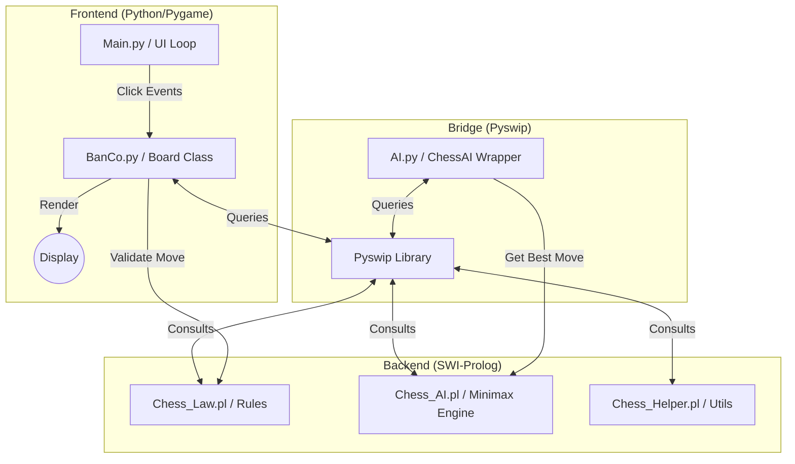

# ♟️ Pixel Chess AI

> A robust, pixel-art style Chess application featuring a Python-based UI and a powerful Prolog logic engine.


## 📋 Table of Contents

1. [Introduction](#-introduction)
2. [Key Features](#-key-features)
3. [Overall Architecture](#-overall-architecture)
4. [Folder Structure](#-folder-structure)
5. [Prerequisites & Installation](#-prerequisites--installation)
6. [Running the Project](#-running-the-project)
7. [Environment Configuration](#-environment-configuration)
8. [Contribution Guidelines](#-contribution-guidelines)
9. [Roadmap](#-roadmap)
10. [License](#-license)

---

## 📖 Introduction

**Pixel Chess AI** is a university project (CPPLT/Project_CK) that bridges the gap between modern interactive graphics and classical logic programming. It creates a seamless chess experience by leveraging **Pygame** for a responsive, pixel-perfect interface and **SWI-Prolog** for rigorous game state management and move validation.

This project demonstrates how declarative programming (Prolog) can be effectively embedded within an imperative application (Python) to handle complex rule-based systems like Chess.

The project was born out of a desire to explore the synergy between high-level logic programming and modern application development. By utilizing Prolog's powerful backtracking and pattern matching capabilities, the AI can evaluate board states with a clarity that purely imperative languages often struggle to express concisely. Meanwhile, Python provides the flexibility and rich ecosystem needed to deliver a smooth, engaging user experience.

## ✨ Key Features

- **🎮 Multiple Game Modes**:
  - **Player vs. Player (PvP)**: Classic local multiplayer.
  - **Player vs. AI**: Challenge the computer with 3 difficulty levels:
    - 🟢 **Easy**: Random moves mixed with basic heuristics.
    - 🟡 **Normal**: Intermediate depth search.
    - 🔴 **Hard**: Advanced Minimax with Alpha-Beta Pruning.
- **🎨 Retro Aesthetics**: Custom-designed pixel art assets for board, pieces, and UI elements.
- **🧠 Intelligent Engine**:
  - **Minimax Algorithm**: Decision making with look-ahead.
  - **Alpha-Beta Pruning**: Optimized search performance.
  - **Opening Book**: Standardized openings for the first few moves.
  - **Transposition Tables**: Caching board states to avoid redundant calculations.
- **⚡ Interactive UI**:
  - Legal move highlighting.
  - Sound effects for moves, captures, and checks.
  - **Undo** and **Reset** functionality.

## 🏗 Overall Architecture

The system follows a **Model-View-Controller (MVC)** adaptation where logic is decoupled from presentation.

### High-Level Diagram



- **Frontend (`Main.py`, `BanCo.py`)**: Handles the graphical user interface, event listeners (mouse clicks), and animation.
- **Backend (`Chess_Law.pl`, `Chess_AI.pl`)**: A purely logical representation of the chess board. It validates moves (`legal_move/6`) and calculates the best next move using Minimax (`find_best_move/7`).
- **Integration (`AI.py`)**: Acts as a wrapper to send Prolog queries from Python and parse the results back into game actions.

## 📂 Folder Structure

```
Chess_AI/
├── 📁 assets/          # Images (pieces, board, UI icons)
├── 📁 fonts/           # Custom pixel fonts
├── 📁 sounds/          # Audio files (click, game start)
├── 📄 Main.py          # Entry point of the application
├── 📄 BanCo.py         # Board logic and rendering class
├── 📄 AI.py            # Python wrapper for the AI engine
├── 📄 Chess_AI.pl      # Prolog: Minimax & evaluation logic
├── 📄 Chess_Law.pl     # Prolog: Move validation & game rules
└── 📄 Chess_Helper.pl  # Prolog: Helper predicates
```

## ⚙ Prerequisites & Installation

### 1. System Requirements

- **OS**: Windows, macOS, or Linux.
- **Python**: Version 3.8 or higher.
- **SWI-Prolog**: Version 8.x or higher (Must be added to System PATH).

### 2. Installation Steps

1.  **Clone the repository**

    ```bash
    git clone https://github.com/NguyenThanhTrung-N2T/Chess_AI.git
    cd Chess_AI
    ```

2.  **Install Python Dependencies**

    ```bash
    pip install pygame pyswip
    ```

3.  **Install SWI-Prolog**
    - Download from [swi-prolog.org](https://www.swi-prolog.org/download/stable).
    - **CRITICAL**: During installation on Windows, check the box **"Add swipl to the system PATH for all users"**.
    - Verify installation by running `swipl --version` in your terminal.

## 🚀 Running the Project

To start the game, navigate to the project directory and run:

```bash
python Main.py
```

### Troubleshooting

> **Error: `PySwip` cannot find `libswipl.dll`**

- Ensure the `bin` folder of your SWI-Prolog installation (e.g., `C:\Program Files\swipl\bin`) is in your System Environment Variables (`PATH`).
- Restart your terminal/IDE after installing Prolog.

## 🔧 Environment Configuration

This project creates **dynamic files** or modifies logic at runtime (Prolog asserts/retracts facts).

- Ensure the project directory has **write permissions**.
- No `.env` file is required for local execution.

## 🤝 Contribution Guidelines

We welcome contributions! Please follow these steps:

1.  **Fork** the repository.
2.  Create a feature branch: `git checkout -b feature/AmazingFeature`.
3.  Commit your changes: `git commit -m 'Add some AmazingFeature'`.
4.  Push to the branch: `git push origin feature/AmazingFeature`.
5.  Open a **Pull Request**.

Please ensure your code follows the existing style (variable naming, comments) and that existing Prolog tests pass.

## 🗺 Roadmap

- [ ] Add "En Passant" and "Castling" logic (if not fully implemented).
- [ ] Improve AI evaluation function (Endgame tablebases).
- [ ] Network Multiplayer Mode.
- [ ] Save/Load Game functionality.

## � About the Authors

**Pixel Chess AI** was developed by **Nguyen Thanh Trung (N2T)** as part of the **CPPLT (C++ Programming Language & Techniques)** final project for **Semester 4**.

- **GitHub**: [NguyenThanhTrung-N2T](https://github.com/NguyenThanhTrung-N2T)
- **Email**: [nguyentrung191225@gmail.com]

We are passionate about AI, Game Development, and making complex logic accessible through clean design.

## �📄 License

Distributed under the **MIT License**. See `LICENSE` for more information.

---

_Created with ❤️ by the Project Team - 2026_
